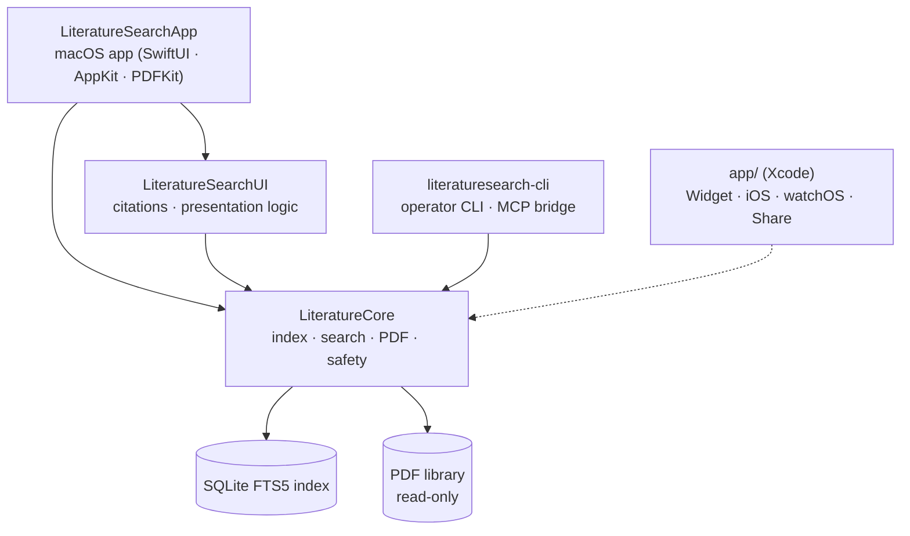

# LiteratureSearch

A local-first macOS app for finding exact passages — and the pages they sit on — in a collection of Chinese and English PDFs.

[中文版](README.zh-CN.md) · [GitHub Releases](https://github.com/liangsiweiethan-wq/literature-search/releases) · MIT licensed

- **Page-level full-text search** across CJK and Latin PDFs, with pinyin title search.
- **Back to the original**: every hit opens the source PDF at the exact page and text range, after re-checking the file fingerprint.
- **Citation-ready**: 21 citation formats, conservative page numbering, BibTeX and annotated-PDF export.
- **Private by default**: the library is read-only, the index stays on the machine, network and AI features are opt-in.

## Public preview

The release includes an illustrated Chinese guide and a three-page sample PDF. Search for `灯光校准`, expand the matching book, and open the hit on PDF page 2. This workflow was verified from the disk image on an Apple Silicon Mac.

The DMG on GitHub Releases is the local verification build. It uses ad hoc signing and has yet to be notarized by Apple. To try the app with Xcode, build from source using the steps below.

## Contents

- [Quick start](#quick-start)
- [Why](#why)
- [Features](#features)
- [Project structure](#project-structure)
- [Design principles](#design-principles)
- [Build and test](#build-and-test)
- [Status and limitations](#status-and-limitations)
- [Roadmap](#roadmap)
- [Contributing and license](#contributing-and-license)

## Quick start

Source build requirements: macOS 13+, Xcode 16+ (Swift 6). Installation and search were verified on macOS 26.6.2.

```bash
# 1. Build (the tests and the sample generator use the CLI binary).
swift build

# 2. Generate a synthetic sample library — no real books needed.
mkdir -p sample-library
swift run literaturesearch-cli genpdf --out sample-library/sample.pdf \
  --page "Sample page one" --page "Sample page two" --page "Sample page three"

# 3. Launch the app, choose ./sample-library as the library, index it, and search.
swift run LiteratureSearchApp
```

`genpdf` writes one PDF page per `--page` argument containing exactly that text, so the whole flow runs offline with no real books.

To test the same library from the terminal, create a separate index and search for a passage from page 2.

```bash
swift run literaturesearch-cli index sample-library --db .build/sample-index.db
swift run literaturesearch-cli search "page two" --db .build/sample-index.db
```

## Why

Humanities and social-science research depends on exact citations: a sentence must be quoted correctly, attributed to the right edition, and pinned to a page a reader can verify — across hundreds or thousands of PDFs in several scripts.

- Spotlight and PDF-viewer search find words, but do not keep a reliable page coordinate, distinguish printed pages from PDF page indexes, or stay attached to the right file after the library changes.
- Reference managers are organised around bibliographic records, not page-level full-text retrieval.
- Cloud search asks researchers to upload material that may be copyrighted, embargoed, or private.

LiteratureSearch treats the local PDF library as the source of truth: it indexes files in place, returns page-level evidence, and keeps the index and queries on the machine.

## Features

**Search** — CJK substring, Latin word, multi-word AND, and pinyin book-title search; page-level snippets that jump to the exact text range; exclusion rules applied before content is read and re-checked when a result is opened.

**Page semantics** — three separate concepts: physical page (always known), PDF `/PageLabels` (only when declared), and printed page (only from a user-supplied CSV page map). Invalid map rows are rejected and reported; printed pages never overwrite a known value.

**Reading and notes** — highlights, underlines, page notes, favourites, smart collections, reading history, and a daily quote. Notes live in the app database, never inside the original PDF; annotated export always writes a new file.

**Citation and export** — 21 formats, including Chinese law-journal styles, GB/T 7714-2015, Bluebook, OSCOLA, Chicago 18, APA 7, MLA 9, Harvard, Vancouver, IEEE, AGLC, McGill, and AMA. Missing metadata is omitted, never invented.

**Integrations** — WidgetKit widget with `literaturesearch://` deep links; optional read-only HTTP API on `127.0.0.1` with a per-launch token (off by default); stdio MCP bridge for local agents; optional iOS/iPadOS and watchOS companions.

**Optional extras** — OCR ingest from a user-authored manifest (both PDFs fingerprinted); online metadata lookup from Crossref, arXiv, DBLP, Semantic Scholar, and Open Library (off by default); content categories from configurable folder names (no folders configured by default, so nothing is categorised until you set them); optional one-way WebDAV download of new PDFs from another device into the library.

## Project structure

### Modules



| Module | Path | Role | Size |
|---|---|---|---:|
| `LiteratureCore` | `Sources/LiteratureCore` | Everything that does not need a UI: storage, search, PDF and page handling, quotes, annotations, sync, local API, safety policy | ~30k lines |
| `LiteratureSearchUI` | `Sources/LiteratureSearchUI` | UI-framework-free presentation: citation formatting, hit routing, localisation, view-state stores | ~5k lines |
| `LiteratureSearchApp` | `Sources/LiteratureSearchApp` | The macOS app: windows, views, settings, local API server | ~18k lines |
| `literaturesearch-cli` | `Sources/literaturesearch-cli` | Explicit-only CLI: index, search, inspect PDFs, generate samples, serve MCP | ~1.6k lines |
| `LiteratureTestKit` + runners | `Tests/` | Synthetic test suites, run by `swift test` or `swift run literaturesearch-tests` | ~28k lines |
| Companion targets | `app/` | Generated Xcode project: Widget, iOS/iPadOS, watchOS, share extension | ~3k lines of Swift |

Dependencies point one way: App → UI → Core, CLI → Core. `LiteratureCore` never imports the UI or app modules or SwiftUI; it uses PDFKit (plus AppKit/UIKit only for PDF rendering).

### Inside `LiteratureCore`

| Area | Main files |
|---|---|
| Index and storage | `IndexStore` (+ migrations, queue, page map, rebind), `IndexingEngine`, `RefreshEngine`, `RefreshJournal`, `SQLiteDatabase`, `LibraryFileWatcher`, `SnapshotManager` |
| Search | `SearchService`, `SearchEngine`, `QuerySyntax`, `SearchNormalization`, `LatinProjection`, `PinyinBookIndex`, `VersionGroup`, `SmartCollections`, `ContentCategory` |
| PDF, pages, OCR | `PDFTextExtractor`, `PageTextSource`, `PageLabels`, `PageNumberService`, `Fingerprint`, `FrontMatter`, `AutoTOC`, `OCRIndexing`, `OcrDrivers`, `CrossValidationGate` |
| Quotes and references | `QuoteExtractor`, `QuoteLocate`, `QuoteMatch`, `QuoteGround`, `CitationPattern`, `ReferenceResolver`, `Metadata*` |
| Annotations and reading | `HighlightStore`, `Annotation*`, `PDFBurnExport`, `Ink*`, `MarksStore`, `FavoritesStore`, `Reading*Store` |
| Sync and companions | `WebDAV*`, `Share*`, `Shared*`, `Watch*`, `SyncModels` |
| Integrations and AI | `LocalAPI`, `MCPBridge`, `DeepLink`, `AIAssistantService`, `AICallLedger`, `FoundationModelsTransport` |
| Safety and settings | `ExclusionPolicy`, `WritingPolicy`, `SecretStore`, `AppSupportPaths` |

### Repository layout

```
Sources/     Swift package modules (see table above)
Tests/       synthetic fixtures, test suites, and the two test runners
app/         generated Xcode project and companion targets
docs/        architecture, schema, page basis, local API, citations
Scripts/     project generator, icon generator, localisation check, privacy gate
.github/     CI: build, test, localisation check, privacy gate
```

Deeper reading: [docs/ARCHITECTURE.md](docs/ARCHITECTURE.md), [docs/SCHEMA.md](docs/SCHEMA.md), [docs/PAGE-BASIS.md](docs/PAGE-BASIS.md), [docs/LOCAL-API.md](docs/LOCAL-API.md).

## Design principles

| Principle | What it means in practice |
|---|---|
| **Local-first, read-only library** | Import and annotated export write new files. Optional WebDAV downloads report filename conflicts and preserve existing files. |
| **Physical page is the only stored page basis** | Hits, highlights, quotes, and reading positions are stored against the 1-based physical page; printed pages and `/PageLabels` are display projections. |
| **Never guess a page number** | Without a declaration or page map, the UI says "unknown" and falls back to the physical page. |
| **Fail visibly** | Exclusion-policy errors stop indexing; a fingerprint mismatch refuses an old citation; zero-hit searches explain why. |
| **Results must return to the original** | Each hit carries the book fingerprint and a UTF-16 range, re-checked before every jump. |
| **Network and AI are opt-in** | The read-only local API listens on loopback. Metadata lookup sends an identifier or title and author, using a cleaned-up filename when the title is missing. AI requests that send text require confirmation. Optional WebDAV snapshot uploads send complete database copies that can contain local file paths, extracted text, and notes. |

## Build and test

```bash
swift build                          # build first: several suites run the CLI binary
swift test                           # swift-testing bridge
swift run literaturesearch-tests     # same cases, executable runner
swift run literaturesearch-cli --help
python3 Scripts/privacy-gate.py      # repository privacy check (also runs in CI)
```

Use Xcode 16 or later for the test suite (`swift-testing`). The app probes for SQLite FTS5 and uses LIKE search when FTS5 is unavailable. Run `swift Scripts/generate-project.swift` to regenerate the Xcode project for app bundles, widgets, and companion targets.

| Measure | Value | Source |
|---|---:|---|
| Synthetic test registry | `Tests/LiteratureCoreTests/AllSuites.swift` | Run with `swift test` |
| Citation formats | 21 | `Sources/LiteratureSearchUI/CitationFormatter.swift` |

## Status and limitations

| Component | Status |
|---|---|
| macOS app, CLI, core | Working; covered by the synthetic test suite |
| Widget, iOS/iPadOS, watchOS, share extension | Build in the generated Xcode project (simulator); no device acceptance yet; sharing data needs a signed app + App Group |

- Interface is Simplified Chinese only for now.
- Printed page numbers need a declaration or a sidecar page map; they are not inferred from OCR or layout.
- Renamed copies are not recognised by path alone; they need an exclusion or rebind record.
- For device signing, set your `DEVELOPMENT_TEAM` in Xcode. Set the target bundle IDs in [the project generator](Scripts/generate-project.swift), update the iOS companion ID in [the watch Info.plist](app/Support/LiteratureSearchWatch-Info.plist), and regenerate the project. Use the same App Group ID in the target entitlements and the container lookups in `SharedHistoryStore`, `ShareReceive`, `WatchCompanionCache`, and `WatchSummaryCache`.
- The App Group test runs its container branch only under a signed host (`LIT_APPGROUP_AVAILABLE`); otherwise it checks the documented fallback.
- The repository ships synthetic fixtures only — no real library, index, or credentials.

## Roadmap

- Lower full-command search latency, especially opening a large index.
- Calibrate the dual-engine OCR cross-validation threshold before enabling it by default.
- Strengthen the iOS/iPadOS companion and cross-edition page alignment.
- Add templates for journal articles, theses, court decisions, and legislation where metadata supports them.
- Better import and rebind workflows for renamed or reorganised libraries.

## Contributing and license

See [CONTRIBUTING.md](CONTRIBUTING.md) for conventions, test fixtures, and the privacy gate. Released under the [MIT License](LICENSE).
