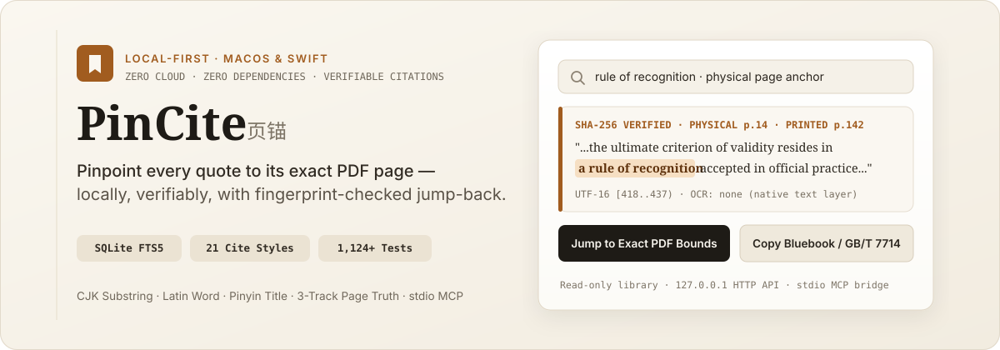
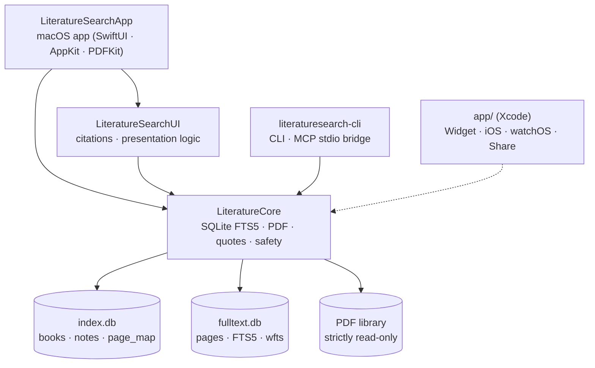

<div align="center">



# PinCite (页锚)

**Pinpoint every quote to its exact PDF page — locally, verifiably, with zero dependencies.**

[](https://github.com/liangsiweiethan-wq/pincite/releases)
[](https://github.com/liangsiweiethan-wq/pincite)
[](https://swift.org)
[](#architecture)
[](#build-and-test)
[](LICENSE)

[中文版](README.zh-CN.md) · [Download macOS DMG](https://github.com/liangsiweiethan-wq/pincite/releases) · [Architecture](docs/ARCHITECTURE.md) · [Launch Kit](docs/LAUNCH-KIT.md)

</div>

---

**PinCite** (formerly *LiteratureSearch*) is a local-first macOS research tool that finds exact passages across Chinese and English PDF libraries and opens the source PDF directly at the verified page and UTF-16 text bounds — never altering your library and never guessing page numbers.

## Why PinCite?

Scholars, legal researchers, and technical writers verify claims against thousands of multilingual PDFs. Standard tools break on exact citation workflows:

| Capability | PinCite | Spotlight / Preview | Zotero / Reference Managers | Cloud AI / PDF RAG |
|---|:---:|:---:|:---:|:---:|
| **Exact UTF-16 hit bounds in PDF** | Yes | Page/scroll only | Metadata-first | Chunks lose exact bounds |
| **Physical vs. `/PageLabels` vs. Printed page** | **3-track strict** | Mixed / fabricated | Manual note only | Frequently hallucinated |
| **Fingerprint verification on jump-back** | **SHA-256 fail-closed** | None | Path-only | No live file anchor |
| **Library stays read-only & 100% offline** | **Yes (zero cloud)** | Local | Local + sync | Requires upload / API |
| **CJK substring + Latin word + Pinyin title** | **Yes** | Basic OS index | Title/metadata | Embedding approximations |
| **21 citation formats + stdio MCP bridge** | **Built-in** | None | Citation plugins | Prompt-dependent |

## Highlights

- **Page-level multi-script search** — CJK substring matching, Latin word indexing (`pages_wfts`), multi-term `AND` queries, and Pinyin book-title search.
- **Verified jump-back to source** — Every hit carries a SHA-256 content fingerprint and exact UTF-16 `[start, end)` range. Before opening, PinCite re-checks the file fingerprint so moved or edited PDFs fail visibly instead of silently opening the wrong page.
- **Three-track page truth** — Strictly separates **physical page** (1-based PDF index, always known), **PDF `/PageLabels`** (trusted only when declared in raw PDF structure), and **printed page** (only from a user-imported CSV page map). Unknown numbers are reported as unknown — never inferred.
- **Sovereign notes & 21 citation styles** — Highlights, underlines, page notes, ink strokes, smart collections, and daily quotes live in PinCite's own SQLite database. Supports 21 conservative citation formats (Chinese law-journal styles, GB/T 7714-2015, Bluebook, OSCOLA, Chicago 18, APA 7, MLA 9, Harvard, Vancouver, IEEE, AGLC, McGill, AMA), BibTeX, and non-destructive annotated PDF export.
- **Agent & tool ready (opt-in)** — Built-in **stdio MCP server** (`literaturesearch-cli mcp-serve`), optional **loopback-only HTTP API** on `127.0.0.1` with per-launch bearer token, WidgetKit extensions, and optional iOS/iPadOS/watchOS companion targets.
- **Private by default** — Zero external SwiftPM dependencies. Zero telemetry. Network metadata lookups (Crossref, arXiv, DBLP, Semantic Scholar, Open Library), WebDAV sync, and AI assistance are all off until explicitly enabled.

## Quick start

### Option 1 — Download macOS DMG (No Xcode needed)

1. Download `PinCite-0.3.0-macOS-adhoc.dmg` from [GitHub Releases](https://github.com/liangsiweiethan-wq/pincite/releases).
2. Drag `LiteratureSearch.app` (displayed as **PinCite**) into `/Applications`.
3. Because this preview DMG uses ad-hoc signing without Apple notarization, strip the quarantine attribute once before first launch (or Control-click → **Open**):
   ```bash
   xattr -cr /Applications/LiteratureSearch.app
   ```
4. Try searching the bundled `PinCite-QuickStart.pdf` (look for `pinpoint` or `页码三分离`) to test verified jump-back right out of the box.

### Option 2 — Build & test from source (30 seconds)

Requires **macOS 13+** and **Xcode 16+** (Swift 6).

```bash
# 1. Build core, CLI, and macOS app (the CLI binary is also used by tests)
swift build

# 2. Generate a synthetic offline sample library — no real books needed
mkdir -p sample-library
swift run literaturesearch-cli genpdf --out sample-library/sample.pdf \
  --page "Sample page one: archival foundation" \
  --page "Sample page two: pinpoint citation anchor" \
  --page "Sample page three: bibliography check"

# 3. Launch the macOS app, select ./sample-library, index it, and search "pinpoint"
swift run LiteratureSearchApp
```

Or run everything straight from the terminal:

```bash
swift run literaturesearch-cli index sample-library --db .build/sample-index.db
swift run literaturesearch-cli search "pinpoint" --db .build/sample-index.db
```

## Architecture

PinCite enforces strict one-way dependencies (`App → UI → Core`, `CLI → Core`) and ships with **zero external Swift package dependencies** — built solely on Apple system frameworks (`Foundation`, `PDFKit`, `CoreText`, `SQLite3`, `CryptoKit`, `SwiftUI`, `Network`).



| Module | Path | Role |
|---|---|---|
| `LiteratureCore` | `Sources/LiteratureCore` | Storage (two-DB `index.db` + `fulltext.db` split), search, PDF extraction, 3-track pages, quotes, annotations, WebDAV, local API, MCP, exclusion policy |
| `LiteratureSearchUI` | `Sources/LiteratureSearchUI` | Framework-agnostic presentation logic: 21 citation formatters, hit routing, quote normalization, localization (`L10n`), view stores |
| `LiteratureSearchApp` | `Sources/LiteratureSearchApp` | Native macOS SwiftUI + AppKit desktop app, PDFKit reader with bounds highlighting, loopback HTTP host |
| `literaturesearch-cli` | `Sources/literaturesearch-cli` | Explicit-only operator CLI: `probe`, `index`, `search`, `pdf-info`, `genpdf`, `mcp-serve`, `rebind-renames`, `backfill-latin` |
| `LiteratureTestKit` | `Tests/` | 1,124+ synthetic test cases across 128 suites (including 33 architectural & security `DesignGuard` assertions) |
| Companion targets | `app/` | Deterministically generated Xcode project (`Scripts/generate-project.swift`) for macOS app, WidgetKit, iOS/iPadOS, watchOS, and Share Extension |

> **Note on internal identifiers:** To preserve 100% compatibility with existing index databases, URL schemes (`literaturesearch://`), and test guards, Swift modules (`LiteratureCore`, `LiteratureSearchUI`, `LiteratureSearchApp`, `literaturesearch-cli`) retain their original `Literature*` target names while user-facing branding uses **PinCite**.

Deep dives: [Architecture](docs/ARCHITECTURE.md) · [Database Schema](docs/SCHEMA.md) · [Page Basis](docs/PAGE-BASIS.md) · [Citation Scenarios](docs/CITATION-SCENARIOS.md) · [Local HTTP API](docs/LOCAL-API.md) · [URI Scheme](docs/URI-SCHEME.md) · [Note Sovereignty](docs/NOTE-SOVEREIGNTY.md)

## Design principles

| Principle | Enforcement |
|---|---|
| **Read-only source library** | PinCite never modifies user PDFs. Annotated export writes new files; WebDAV sync rejects filename collisions without overwriting local originals. |
| **Physical page is the single source of truth** | Hits, highlights, quotes, and reading progress bind to 1-based physical pages; `/PageLabels` and printed numbers are read-only projections. |
| **Fail closed, fail visibly** | Invalid exclusion rules block indexing; mismatched SHA-256 fingerprints reject stale jumps; unknown page numbers display as unknown; empty hits explain why. |
| **Zero-warning strictness** | Both production modules and all 1,124+ test cases build cleanly with `-Xswiftc -warnings-as-errors`. |

## Build and test

```bash
# Run the complete preflight gate (privacy check, project regen, L10n check, zero-warning build, 1,124+ tests)
Scripts/preflight.sh

# Or run individual commands:
swift build --build-tests -Xswiftc -warnings-as-errors
swift test
swift run literaturesearch-tests
python3 -I Scripts/privacy-gate.py --self-test
swift Scripts/generate-project.swift
Scripts/package-release.sh 0.3.0
```

## Status and limitations

- **macOS app, CLI, and core:** Production-ready and covered by 1,124+ synthetic tests.
- **macOS UI language:** Currently Simplified Chinese; full English/Chinese runtime toggle is scheduled for `v0.4.0`. The CLI, docs, and README are English-first / bilingual.
- **Companion targets (iOS, watchOS, Widgets, Share Extension):** Build cleanly for simulators in CI (`CODE_SIGNING_ALLOWED=NO`). Physical device deployment requires configuring your own `DEVELOPMENT_TEAM` and App Group IDs in [Scripts/generate-project.swift](Scripts/generate-project.swift) and entitlements.
- **Ad-hoc macOS binary:** Release DMGs are ad-hoc signed without Apple notarization until an Apple Developer ID is configured.

## Roadmap

- **v0.4.0 — Full EN/zh-CN UI Localization & Coordinator Split:** Complete English UI switch in `L10n`, break `AppState` into focused `Search` / `Reader` / `Library` / `AI` coordinators, and ship dark/light screenshots.
- **OCR Calibration:** Tune dual-engine OCR cross-validation thresholds before enabling automatic verification by default.
- **Extended Legal & Academic Templates:** Add structured templates for journal articles, theses, court decisions, and statutory collections.
- **Companion Device Polish:** End-to-end physical iOS/iPadOS & watchOS replica verification.

## Contributing and license

See [CONTRIBUTING.md](CONTRIBUTING.md), [CODE_OF_CONDUCT.md](CODE_OF_CONDUCT.md), and [SECURITY.md](SECURITY.md).
Released under the [MIT License](LICENSE).
