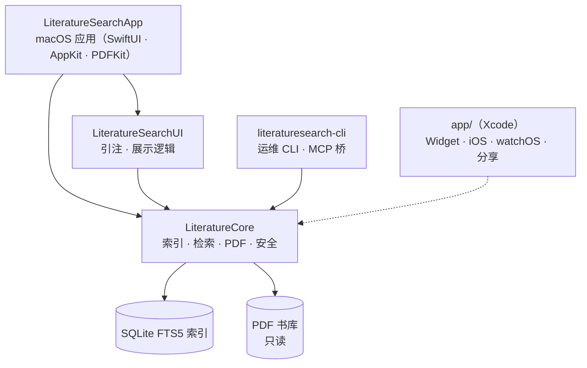

# LiteratureSearch

本地优先的 macOS 文献检索工具：在中英文 PDF 集合中定位原文段落，并回到它所在的页。

[English](README.md) · [下载与发布记录](https://github.com/liangsiweiethan-wq/literature-search/releases) · MIT 许可

- **页级全文检索**：中文与西文 PDF 通用，支持拼音书名检索。
- **回到原件**：每条结果先核对文件指纹，再打开原 PDF 并定位到准确的页与文字区间。
- **可直接引用**：21 种引注体例，页码处理保守，支持 BibTeX 与带批注 PDF 导出。
- **默认私密**：书库只读，索引留在本机，网络与 AI 功能需主动开启。

## 首发预览

想先看一遍完整流程，可以下载中文图文指引和三页样例。搜索「灯光校准」，展开书目 `试点记录.pdf`，点击命中条目即可打开原文第 2 页。这个流程已在 Apple Silicon Mac 上从磁盘映像安装并实测通过。

GitHub Releases 中的 DMG 是本机验收包，采用临时签名，尚未通过 Apple 公证。具备 Xcode 的试用者可以按下方步骤从源码运行应用。

## 目录

- [快速上手](#快速上手)
- [为什么做](#为什么做)
- [功能](#功能)
- [软件结构](#软件结构)
- [设计原则](#设计原则)
- [构建与测试](#构建与测试)
- [状态与限制](#状态与限制)
- [路线图](#路线图)
- [贡献与许可](#贡献与许可)

## 快速上手

源码构建要求 macOS 13+、Xcode 16+（Swift 6）。现有版本在 macOS 26.6.2 上完成安装与检索流程验收。

```bash
# 1. 构建（测试与样例生成都会用到 CLI 二进制）。
swift build

# 2. 生成合成样例书库——不需要任何真实书籍。
mkdir -p sample-library
swift run literaturesearch-cli genpdf --out sample-library/sample.pdf \
  --page "Sample page one" --page "Sample page two" --page "Sample page three"

# 3. 启动应用，选择 ./sample-library 作为书库，建立索引后检索。
swift run LiteratureSearchApp
```

`genpdf` 为每个 `--page` 参数生成一页，内容就是传入的文字；整个流程离线完成，不需要真实书籍。

也可以在终端为同一个书库建立单独的索引，检索第 2 页的文字。

```bash
swift run literaturesearch-cli index sample-library --db .build/sample-index.db
swift run literaturesearch-cli search "page two" --db .build/sample-index.db
```

## 为什么做

人文社科研究依赖精确引证：一句话要引得对，出处要落到可核对的版次与页码——而材料往往散在几百上千份、跨语言与字符集的 PDF 里。

- Spotlight 和 PDF 阅读器能找到词，却不保留可靠的页码坐标，不区分印刷页与 PDF 物理页，书库变动后结果还可能指向另一份文件。
- 文献管理器围绕书目记录组织，不以页级全文检索为中心。
- 云端检索要求上传可能受版权、禁运或保密约束的材料。

LiteratureSearch 把本地 PDF 书库当作事实源：就地索引，返回页级证据，索引与查询都留在本机。

## 功能

**检索**——中文子串、西文词、多词 AND 与拼音书名检索；页级片段可回跳到原文区间；排除规则在读取内容前生效，打开结果时再次复查。

**页码语义**——三个概念分开：物理页（恒知）、PDF `/PageLabels`（仅在文档声明时采信）、印刷页（仅来自用户提供的 CSV 页码表）。无效行拒收并报告；印刷页不覆盖已知值。

**阅读与笔记**——高亮、下划线、页面笔记、收藏、智能合集、阅读历史与每日一句。笔记存在应用数据库里，绝不写入原 PDF；带批注导出总是生成新文件。

**引注与导出**——21 种体例，包括中文法学期刊体例、GB/T 7714-2015、Bluebook、OSCOLA、Chicago 18、APA 7、MLA 9、Harvard、Vancouver、IEEE、AGLC、McGill、AMA。缺失的元数据直接省略，绝不编造。

**集成**——WidgetKit 小组件与 `literaturesearch://` 深链；可选的只读 HTTP API，只绑定 `127.0.0.1`，每次启动生成新 token（默认关闭）；供本机智能体使用的 stdio MCP 桥；可选的 iOS/iPadOS 与 watchOS 伴生端。

**可选扩展**——按用户编写的清单导入 OCR 文本层（两侧 PDF 都做指纹）；从 Crossref、arXiv、DBLP、Semantic Scholar、Open Library 在线补全元数据（默认关闭）；按可配置的文件夹名划分内容类别（默认未配置任何文件夹，因此不做分类）；可选的单向 WebDAV 下载，把其他设备上的新 PDF 拉进书库。

## 软件结构

### 模块



| 模块 | 路径 | 职责 | 规模 |
|---|---|---|---:|
| `LiteratureCore` | `Sources/LiteratureCore` | 一切不依赖界面的能力：存储、检索、PDF 与页码、引句、批注、同步、本机 API、安全策略 | 约 3 万行 |
| `LiteratureSearchUI` | `Sources/LiteratureSearchUI` | 不依赖 UI 框架的展示层：引注格式化、命中路由、本地化、视图状态存储 | 约 5 千行 |
| `LiteratureSearchApp` | `Sources/LiteratureSearchApp` | macOS 应用：窗口、视图、设置、本机 API 服务 | 约 1.8 万行 |
| `literaturesearch-cli` | `Sources/literaturesearch-cli` | 只做显式操作的 CLI：索引、检索、PDF 检查、生成样例、MCP 服务 | 约 1.6 千行 |
| `LiteratureTestKit` 与运行器 | `Tests/` | 合成测试套件，由 `swift test` 或 `swift run literaturesearch-tests` 运行 | 约 2.8 万行 |
| 伴生目标 | `app/` | 生成的 Xcode 工程：Widget、iOS/iPadOS、watchOS、分享扩展 | Swift 约 3 千行 |

依赖单向：App → UI → Core，CLI → Core。`LiteratureCore` 不引用应用模块、界面模块或 SwiftUI；只使用 PDFKit（仅在渲染 PDF 时用到 AppKit/UIKit）。

### `LiteratureCore` 内部

| 领域 | 主要文件 |
|---|---|
| 索引与存储 | `IndexStore`（含迁移、队列、页码表、重绑）、`IndexingEngine`、`RefreshEngine`、`RefreshJournal`、`SQLiteDatabase`、`LibraryFileWatcher`、`SnapshotManager` |
| 检索 | `SearchService`、`SearchEngine`、`QuerySyntax`、`SearchNormalization`、`LatinProjection`、`PinyinBookIndex`、`VersionGroup`、`SmartCollections`、`ContentCategory` |
| PDF、页码、OCR | `PDFTextExtractor`、`PageTextSource`、`PageLabels`、`PageNumberService`、`Fingerprint`、`FrontMatter`、`AutoTOC`、`OCRIndexing`、`OcrDrivers`、`CrossValidationGate` |
| 引句与参考文献 | `QuoteExtractor`、`QuoteLocate`、`QuoteMatch`、`QuoteGround`、`CitationPattern`、`ReferenceResolver`、`Metadata*` |
| 批注与阅读 | `HighlightStore`、`Annotation*`、`PDFBurnExport`、`Ink*`、`MarksStore`、`FavoritesStore`、`Reading*Store` |
| 同步与伴生端 | `WebDAV*`、`Share*`、`Shared*`、`Watch*`、`SyncModels` |
| 集成与 AI | `LocalAPI`、`MCPBridge`、`DeepLink`、`AIAssistantService`、`AICallLedger`、`FoundationModelsTransport` |
| 安全与设置 | `ExclusionPolicy`、`WritingPolicy`、`SecretStore`、`AppSupportPaths` |

### 仓库布局

```
Sources/     Swift 包模块（见上表）
Tests/       合成夹具、测试套件与两个测试运行器
app/         生成的 Xcode 工程与伴生目标
docs/        架构、数据表、页码基准、本机 API、引注
Scripts/     工程生成、图标生成、本地化检查、隐私门禁
.github/     CI：构建、测试、本地化检查、隐私门禁
```

延伸阅读：[docs/ARCHITECTURE.md](docs/ARCHITECTURE.md)、[docs/SCHEMA.md](docs/SCHEMA.md)、[docs/PAGE-BASIS.md](docs/PAGE-BASIS.md)、[docs/LOCAL-API.md](docs/LOCAL-API.md)。

## 设计原则

| 原则 | 具体含义 |
|---|---|
| **本地优先，书库只读** | 导入与带批注导出都写新文件。可选的 WebDAV 下载会报告同名冲突并保留本地原件。 |
| **只以物理页为存储基准** | 命中、高亮、引句、阅读位置都按 1-based 物理页存储；印刷页与 `/PageLabels` 只是显示投影。 |
| **不猜页码** | 没有文档声明或页码表时，界面显示“未知”并回退物理页。 |
| **失败要说出来** | 排除策略出错就停止索引；指纹不匹配就拒绝旧引用；零命中会说明原因。 |
| **结果必须回得到原件** | 每条命中携带书的指纹与 UTF-16 区间，每次跳转前都重新核对。 |
| **网络与 AI 默认关闭** | 本机只读 API 只绑定环回地址。在线补全会发送标识符或标题和作者，缺少标题时使用整理后的文件名。AI 外发前逐次确认。可选的 WebDAV 索引上传会发送完整数据库快照，其中可能包含本机文件路径、提取的全文和笔记。 |

## 构建与测试

```bash
swift build                          # 先构建：部分测试会调用 CLI 二进制
swift test                           # swift-testing 桥
swift run literaturesearch-tests     # 同一批用例，可执行运行器
swift run literaturesearch-cli --help
python3 Scripts/privacy-gate.py      # 仓库隐私检查（CI 中也会运行）
```

测试套件使用 `swift-testing`，需要 Xcode 16 或更新版本。应用启动时探测 SQLite FTS5，缺少 FTS5 时使用 LIKE 检索。构建应用包、小组件和伴生端需要使用 Xcode 工程，可运行 `swift Scripts/generate-project.swift` 重新生成。

| 指标 | 数值 | 来源 |
|---|---:|---|
| 合成测试注册表 | `Tests/LiteratureCoreTests/AllSuites.swift` | 运行 `swift test` |
| 引注体例 | 21 | `Sources/LiteratureSearchUI/CitationFormatter.swift` |

## 状态与限制

| 组件 | 状态 |
|---|---|
| macOS 应用、CLI、核心库 | 可用；由合成测试套件覆盖 |
| Widget、iOS/iPadOS、watchOS、分享扩展 | 可在生成的 Xcode 工程中构建（模拟器）；尚未真机验收；共享数据需签名应用与 App Group |

- 界面目前只有简体中文。
- 印刷页码需要文档声明或页码表，不从 OCR 或版面推断。
- 改名后的副本不能仅凭路径识别，需要排除或重绑记录。
- 真机签名需要在 Xcode 中设置你的 `DEVELOPMENT_TEAM`。在[工程生成脚本](Scripts/generate-project.swift)中修改各目标的 bundle ID，同步更新 [watchOS Info.plist](app/Support/LiteratureSearchWatch-Info.plist) 中的 iOS 伴生 ID，然后重新生成工程。各目标的 entitlements 和 `SharedHistoryStore`、`ShareReceive`、`WatchCompanionCache`、`WatchSummaryCache` 中的共享容器要使用同一个 App Group ID。
- App Group 测试只在签名宿主下（`LIT_APPGROUP_AVAILABLE`）走容器分支，否则校验文档化的回退路径。
- 仓库只包含合成夹具——没有真实书库、索引或凭据。

## 路线图

- 降低完整检索命令的延迟，尤其是打开大型索引的开销。
- 在默认启用前，校准双引擎 OCR 交叉验证阈值。
- 加强 iOS/iPadOS 伴生端与跨版次页码对齐。
- 在元数据足够时，为期刊论文、学位论文、判决与法规增加专门模板。
- 改进改名或重组书库后的导入与重绑流程。

## 贡献与许可

约定、测试夹具与隐私门禁见 [CONTRIBUTING.md](CONTRIBUTING.md)。以 [MIT 许可](LICENSE) 发布。
