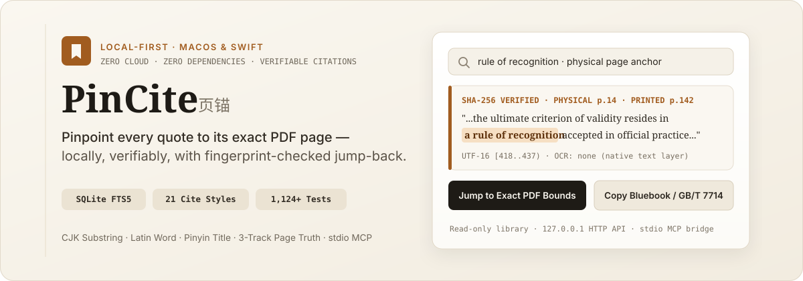
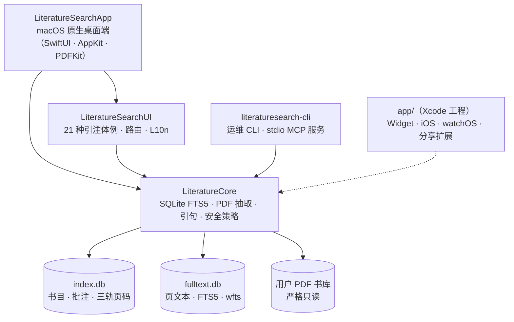

<div align="center">



# PinCite（页锚）

**把每一句引文稳稳钉回 PDF 原页 —— 本地优先、指纹验真、零第三方依赖。**

[](https://github.com/liangsiweiethan-wq/pincite/releases)
[](https://github.com/liangsiweiethan-wq/pincite/actions/workflows/ci.yml)
[](https://github.com/liangsiweiethan-wq/pincite)
[](https://swift.org)
[](#软件架构)
[](#构建与测试)
[](LICENSE)

[English](README.md) · [下载 macOS 安装包](https://github.com/liangsiweiethan-wq/pincite/releases) · [架构设计](docs/ARCHITECTURE.md) · [多社群宣发素材](docs/LAUNCH-KIT.md)

</div>

---

**PinCite（页锚）**（原名 *LiteratureSearch*）是一款专为深度阅读与学术/法律写作打造的 **macOS 原生本地文献精查工具**。面对上千份中英文 PDF 书库，它可以按页秒搜原文片段，点击结果先校对原文件 SHA-256 指纹、再精确跳回那一页并高亮对应 UTF-16 字符区间——**书库严格只读，页码绝不瞎猜，数据绝不出本机。**

## 为什么做 PinCite？

做学术研究、法学实务或长文写作，最耗神的往往不是“搜不到文献”，而是**落笔后回头核对逐字引文与准确页码**。常见方案到了这一步都会掉链子：

| 核心诉求 | PinCite（页锚） | Spotlight / 系统预览 | Zotero 等文献管理 | 云端 AI / PDF RAG |
|---|:---:|:---:|:---:|:---:|
| **点开即跳原页 + 精确高亮选区** | **UTF-16 区间精确高亮** | 仅粗略定位 | 偏题录管理，内文回跳弱 | 分块切片丢失原始位置 |
| **物理页 / `/PageLabels` / 印刷页区分** | **三轨严格分离，绝不混用** | 混算或伪造连续页码 | 依赖人工手记页码 | 高频幻觉与错页 |
| **防止文件被改名/替换后跳错页** | **SHA-256 验真（Fail-Closed）** | 无内容校验 | 仅靠文件路径绑定 | 脱离本地原件校验 |
| **隐私安全与运行形态** | **100% 离线，零第三方依赖** | 本地可用 | 本地 + 云端同步 | 需上传文件或调外部 API |
| **中文 + 西文 + 拼音混排定位** | **Trigram + 词级 + 拼音全支持** | 中文短语易漏或过泛 | 侧重标题与作者元数据 | 语义近义词易漏原词 |
| **引注生成 & 本地 AI Agent 接入** | **21 种引注体例 + 原生 MCP** | 无 | 需额外配置插件 | 依赖提示词约束，易编页码 |

## 核心能力

- **中英混合页级精查，兼顾拼音定位书名** — 将 SQLite FTS5 Trigram、Unicode61 词级投影（`pages_wfts`）与短词精确回退打通；写论文只记得读音或半个词，也能秒级定位到具体书籍与页码。
- **回跳先验指纹，拒绝“默默跳错页”** — 每条命中都绑定原文件 SHA-256 摘要与原文 UTF-16 `[start, end)` 区间。再次点击回跳时先比对文件指纹，文档一旦被改动或替换即明确拦截并提示重绑，绝不静默错位。
- **页码三轨并立，宁缺毋滥** — 严格区分**物理页**（1 起的 PDF 页序，恒知）、**PDF `/PageLabels`**（仅原 PDF 结构显式声明时采信，防止扫描件被系统强行编成 `1, 2, 3...`）与**印刷页**（仅来自用户导入的页码映射表）。没有依据的页码诚实显示未知。
- **笔记主权 + 21 种标准引注** — 高亮、下划线、页面笔记、笔迹、智能合集与每日一句全部存放在软件自有 SQLite 库中，永远不篡改原版 PDF；支持中文法学期刊、GB/T 7714-2015、Bluebook、OSCOLA、Chicago 18、APA 7、MLA 9 等 21 种引注格式、BibTeX 与“写入新副本”的批注 PDF 导出。
- **把“靠谱页码”接进本机 AI 工作流（默认关闭）** — 内置 **stdio MCP 服务**（`literaturesearch-cli mcp-serve`）与可选本机环回 `127.0.0.1` 只读 HTTP API，让本地智能体在查文献时直接引用经过核对的物理页段落，而不是胡编页码。
- **极端克制的隐私边界** — 零第三方 SwiftPM 依赖，零遥测；联网补全题录（Crossref / arXiv / DBLP / Semantic Scholar / Open Library）、WebDAV 同步、AI 辅助全部默认关闭，仅在用户主动触发时放行。

## 快速上手

### 方式一：直接安装 macOS 预览版 DMG（免 Xcode）

1. 前往 [GitHub Releases](https://github.com/liangsiweiethan-wq/pincite/releases) 下载 `PinCite-0.3.0-macOS-adhoc.dmg`。
2. 打开镜像，将 `LiteratureSearch.app`（安装后显示名为 **PinCite**）拖入 `/Applications`（应用程序）。
3. **无公证首次启动说明**：当前版本采用本机临时签名（ad-hoc），尚未配置 Apple Developer ID 公证。拖入应用程序后，请在终端执行一次（或在图标上右键 → 打开）：
   ```bash
   xattr -cr /Applications/LiteratureSearch.app
   ```
4. 镜像内自带 3 页双语体验样书 `PinCite-QuickStart.pdf`，选为书库目录后搜索 `pinpoint` 或 `页码三分离`，无需导入个人书库即可立刻体验完整验真回跳流程。

### 方式二：源码 30 秒构建运行

环境要求：**macOS 13+**、**Xcode 16+**（Swift 6）。

```bash
# 1. 构建核心库、CLI 与 macOS 桌面应用
swift build

# 2. 用内置 CLI 生成纯合成离线测试样书
mkdir -p sample-library
swift run literaturesearch-cli genpdf --out sample-library/sample.pdf \
  --page "Sample page one: archival foundation" \
  --page "Sample page two: pinpoint citation anchor" \
  --page "Sample page three: bibliography check"

# 3. 启动 PinCite，选择 ./sample-library 建库并检索 "pinpoint"
swift run LiteratureSearchApp
```

也可以全程在命令行完成建库、索引与页级查证：

```bash
swift run literaturesearch-cli index sample-library --db .build/sample-index.db
swift run literaturesearch-cli search "pinpoint" --db .build/sample-index.db
```

## 软件架构

PinCite 采用严格单向依赖分层（`App → UI → Core`、`CLI → Core`），**零第三方 Swift 包依赖**，全部由苹果原生系统框架（`Foundation`、`PDFKit`、`CoreText`、`SQLite3`、`CryptoKit`、`SwiftUI`、`Network`）构建。



| 模块 | 路径 | 核心职责 |
|---|---|---|
| `LiteratureCore` | `Sources/LiteratureCore` | `index.db` + `fulltext.db` 双库物理分离、页级检索引擎、PDF 抽取、三轨页码、引句与批注、WebDAV 同步、本机只读 API、MCP 服务与排除规则门禁 |
| `LiteratureSearchUI` | `Sources/LiteratureSearchUI` | 跨平台展示层逻辑：21 种引注格式化、命中路由、引文清洗、`L10n`、刷新台与视图状态库 |
| `LiteratureSearchApp` | `Sources/LiteratureSearchApp` | macOS 原生 SwiftUI + AppKit 书房界面、PDFKit 精准选区阅读器、本机环回 HTTP 宿主 |
| `literaturesearch-cli` | `Sources/literaturesearch-cli` | 显式运维命令行：`probe`、`index`、`search`、`pdf-info`、`genpdf`、`mcp-serve`、`rebind-renames`、`backfill-latin` |
| `LiteratureTestKit` | `Tests/` | 128 个合成测试套件 / 1,130 项全量用例（含 33 项架构与安全红线 `DesignGuard` 守卫断言） |
| 伴生工程 | `app/` | 由 [Scripts/generate-project.swift](Scripts/generate-project.swift) 确定性生成的 Xcode 工程（macOS、Widget、iOS、watchOS、分享扩展） |

> **内部命名说明：** 为保持与既有索引数据库、`literaturesearch://` 深链及测试守卫 100% 向后兼容，Swift 源码 target 与 Bundle ID 沿用 `Literature*` 命名空间，应用展示与项目品牌统一为 **PinCite（页锚）**。

深入技术文档：[架构总览](docs/ARCHITECTURE.md) · [数据库 Schema](docs/SCHEMA.md) · [页码三基准](docs/PAGE-BASIS.md) · [引注场景与体例](docs/CITATION-SCENARIOS.md) · [本机 HTTP API](docs/LOCAL-API.md) · [深链协议](docs/URI-SCHEME.md) · [笔记主权三原则](docs/NOTE-SOVEREIGNTY.md)

## 工程原则

| 原则 | 落地机制 |
|---|---|
| **原件只读，笔记主权** | 绝不修改用户原 PDF；导出带批注 PDF 恒写入新副本；WebDAV 下载遇同名冲突只报错跳过、绝不覆盖原文件。 |
| **物理页作为唯一存储锚点** | 搜索命中、高亮选区、引句与阅读足迹一律绑定 1 起物理页；印刷页与 `/PageLabels` 仅为展示投影。 |
| **失败显式暴露（Fail-Closed）** | 排除规则语法有误立即拒绝启动索引；SHA-256 指纹不匹配直接阻断陈旧回跳；未知页码如实呈报未知；零命中明确给出诊断依据。 |
| **零告警编译纪律** | 全部生产模块与 1,130 项合成测试用例均在 `-Xswiftc -warnings-as-errors` 下以 0 告警通过编译并验证。 |

## 构建与测试

```bash
# 运行完整本地预检门禁（隐私扫描、工程生成确定性、L10n 检查、零告警编译、1,130 项全量测试）
Scripts/preflight.sh

# 或按需分步运行：
swift build --build-tests -Xswiftc -warnings-as-errors
swift test
swift run literaturesearch-tests
python3 -I Scripts/privacy-gate.py --self-test
swift Scripts/generate-project.swift
Scripts/package-release.sh 0.3.0
```

## 当前状态与已知限制

- **macOS 桌面端、CLI 与核心库**：功能完备，1,130 项合成测试在本地及 GitHub `macos-15` CI 全绿通过。
- **桌面端界面语言**：当前桌面 UI 以简体中文为主，计划在 `v0.4.0` 推出应用内英/中双语实时切换；README、技术文档与发布脚本已支持双语。
- **伴生端（iOS / watchOS / Widget / 分享扩展）**：在 CI 中已覆盖全端模拟器编译通过；真机签名安装与 App Group 跨进程容器需在 [Scripts/generate-project.swift](Scripts/generate-project.swift) 与对应 entitlements 中填写你自己的 Apple `DEVELOPMENT_TEAM`。
- **无公证预览签名**：Release DMG 采用 ad-hoc 临时签名，首次打开前请执行一次 `xattr -cr /Applications/LiteratureSearch.app`。

## 演进路线

- **v0.4.0 — 全双语 UI 与状态解耦**：完善 `L10n` 运行时中/英一键切换，将 `AppState` 拆分为 `Search` / `Reader` / `Library` / `AI` 四个独立协调器，并补齐浅/深色实机高清截图。
- **双引擎 OCR 校准**：完成 MinerU 与 Docling 交叉验证阈值校准后开放默认自动比对。
- **扩展法学与学术引注模板**：持续补充期刊论文、学位论文、裁判文书及法律法规等细分引注规则。
- **跨设备伴生端真机联调**：完善 iOS / iPadOS 与 watchOS 只读副本协同阅读体验。

## 参与贡献与开源协议

欢迎阅读 [CONTRIBUTING.md](CONTRIBUTING.md)、[CODE_OF_CONDUCT.md](CODE_OF_CONDUCT.md) 与 [SECURITY.md](SECURITY.md)。
本项目采用 [MIT 协议](LICENSE) 开源，附带完整社区推广文案包：[docs/LAUNCH-KIT.md](docs/LAUNCH-KIT.md)。
