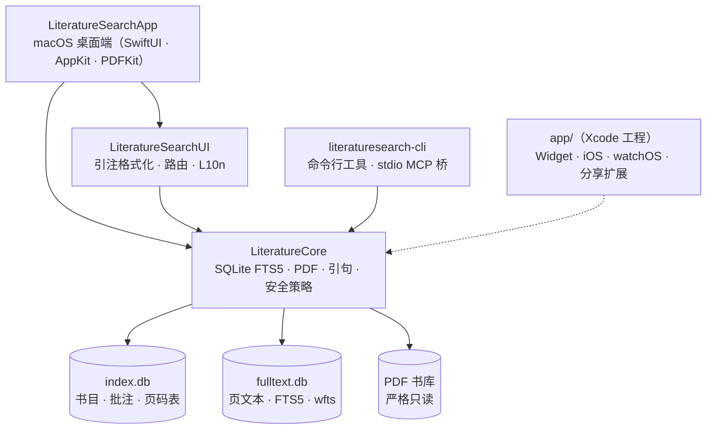

<div align="center">


# PinCite（页锚）

**把每一句引文精准锚定回 PDF 原页 —— 本地优先、指纹验真、零三方依赖。**

[](https://github.com/liangsiweiethan-wq/pincite/releases)
[](https://github.com/liangsiweiethan-wq/pincite)
[](https://swift.org)
[](#软件架构)
[](#构建与测试)
[](LICENSE)

[English](README.md) · [下载 macOS 安装包](https://github.com/liangsiweiethan-wq/pincite/releases) · [架构设计](docs/ARCHITECTURE.md) · [宣发素材包](docs/LAUNCH-KIT.md)

</div>

---

**PinCite（页锚）**（原名 *LiteratureSearch*）是一款本地优先的 macOS 学术文献检索与核对工具：在成百上千份中英文 PDF 中按页精查原文段落，点击命中结果直接回到原 PDF 的精确页码与 UTF-16 字符区间——书库严格只读，页码绝不猜测。

## 为什么做 PinCite？

人文社科、法学、哲学研究以及长文写作极度依赖**逐字核对与准确页码**。现有工具在关键环节都会失灵：

| 核心能力 | PinCite（页锚） | Spotlight / 预览 | Zotero 等文献管理 | 云端 AI / PDF RAG |
|---|:---:|:---:|:---:|:---:|
| **跳回 PDF 原页精确 UTF-16 高亮选区** | 支持 | 仅大致滚动 | 侧重题录元数据 | 分块丢失精确位置 |
| **物理页 / `/PageLabels` / 印刷页严格分离** | **三轨严格分离** | 混用甚至伪造页码 | 需手工记录 | 幻觉与错页频发 |
| **回跳前 SHA-256 指纹验真** | **Fail-Closed 拒跳** | 无校验 | 仅凭路径 | 无本地文件强绑定 |
| **书库只读、100% 离线、零数据出机** | **是（零外部依赖）** | 本地 | 本地 + 同步 | 需上传文件或调用 API |
| **中文子串 + 西文词级 + 拼音书名检索** | **全支持** | 基础系统索引 | 仅标题/元数据 | 语义近似常漏精确词 |
| **内置 21 种引注体例 + MCP 智能体接口** | **原生内置** | 无 | 依赖外置插件 | 依赖提示词约束 |

## 核心亮点

- **中英混合页级全文检索** — 结合 SQLite FTS5 Trigram、Unicode61 词级投影（`pages_wfts`）与短词精确回退，同时支持拼音与简繁书名定位。
- **指纹验证的安全回跳** — 每条命中都携带原文件 SHA-256 指纹与原文 UTF-16 区间。跳转前重新核对文件指纹，避免文件被替换或修改后悄悄跳到错误页码。
- **页码三轨基准，宁缺毋滥** — 严格区分**物理页**（1 起 PDF 页序，恒知）、**PDF `/PageLabels`**（仅文档结构显式声明时采信）与**印刷页**（仅来自用户导入的 CSV 映射表）。未知就是未知，绝不猜测。
- **笔记主权与 21 种引注体例** — 高亮、下划线、页面笔记、笔迹、智能合集与每日一句全部存在软件自有库，绝不改写原版 PDF；支持中文法学期刊、GB/T 7714-2015、Bluebook、OSCOLA、Chicago 18、APA 7、MLA 9 等 21 种体例及 BibTeX、带批注 PDF 副本导出。
- **为工作流与 Agent 就绪（默认关闭，按需启用）** — 内置 **stdio MCP 服务**（`literaturesearch-cli mcp-serve`）、可选本机环回 `127.0.0.1` 只读 HTTP API、桌面 Widget 与 iOS/watchOS 伴生端工程。
- **默认彻底私密** — 零第三方 SwiftPM 依赖，无任何遥测。在线元数据补全（Crossref/arXiv/DBLP/Semantic Scholar/Open Library）、WebDAV 同步、AI 辅助均默认关闭且逐次确认。

## 快速上手

### 方式一：直接安装 macOS DMG（无需 Xcode）

1. 从 [GitHub Releases](https://github.com/liangsiweiethan-wq/pincite/releases) 下载 `PinCite-0.3.0-macOS-adhoc.dmg`。
2. 将 `LiteratureSearch.app`（桌面显示名为 **PinCite**）拖入 `/Applications`（应用程序）。
3. 因当前预览版采用本机临时签名（ad-hoc）、尚未经过 Apple 公证，首次打开前请在终端执行一次清除隔离属性（或右键 → 打开）：
   ```bash
   xattr -cr /Applications/LiteratureSearch.app
   ```
4. 镜像内附带 3 页双语合成测试样书 `PinCite-QuickStart.pdf`，导入后即可检索 `pinpoint` 或 `页码三分离` 体验完整回跳。

### 方式二：从源码 30 秒构建运行

要求 **macOS 13+** 与 **Xcode 16+**（Swift 6）。

```bash
# 1. 构建核心库、CLI 与 macOS 应用
swift build

# 2. 生成纯合成离线样例书库（无需任何真实电子书）
mkdir -p sample-library
swift run literaturesearch-cli genpdf --out sample-library/sample.pdf \
  --page "Sample page one: archival foundation" \
  --page "Sample page two: pinpoint citation anchor" \
  --page "Sample page three: bibliography check"

# 3. 启动 macOS 应用，选择 ./sample-library 建库并检索 "pinpoint"
swift run LiteratureSearchApp
```

也可以直接在终端建立索引并运行页级检索：

```bash
swift run literaturesearch-cli index sample-library --db .build/sample-index.db
swift run literaturesearch-cli search "pinpoint" --db .build/sample-index.db
```

## 软件架构

PinCite 采用严格单向分层架构（`App → UI → Core`、`CLI → Core`），**零第三方 Swift 包依赖**，全部能力基于苹果系统框架（`Foundation`、`PDFKit`、`CoreText`、`SQLite3`、`CryptoKit`、`SwiftUI`、`Network`）构建。



| 模块 | 路径 | 职责 |
|---|---|---|
| `LiteratureCore` | `Sources/LiteratureCore` | 数据存储（`index.db` + `fulltext.db` 两库物理分离）、全文检索、PDF 抽取、三轨页码、引句与批注、WebDAV、本机 API、MCP 桥与安全策略 |
| `LiteratureSearchUI` | `Sources/LiteratureSearchUI` | 不依赖 UI 框架的展示逻辑：21 种引注体例、命中路由、引文规整、`L10n`、视图状态库 |
| `LiteratureSearchApp` | `Sources/LiteratureSearchApp` | 原生 macOS 桌面应用、PDFKit 原件高亮阅读器、环回 HTTP 宿主 |
| `literaturesearch-cli` | `Sources/literaturesearch-cli` | 显式运维 CLI：`probe`、`index`、`search`、`pdf-info`、`genpdf`、`mcp-serve`、`rebind-renames`、`backfill-latin` |
| `LiteratureTestKit` | `Tests/` | 128 个合成测试套件 / 1,124+ 用例（含 33 项架构与安全红线 `DesignGuard` 断言） |
| 伴生工程 | `app/` | 由 [Scripts/generate-project.swift](Scripts/generate-project.swift) 确定性生成的 Xcode 工程（macOS、Widget、iOS、watchOS、Share 扩展） |

> **关于内部模块命名：** 为保持与既有索引库、`literaturesearch://` 深链及测试守卫的 100% 兼容，底层 Swift target 与协议名继续沿用 `Literature*` 命名空间，面向用户的应用展示与产品品牌统一为 **PinCite（页锚）**。

深入设计文档：[架构总览](docs/ARCHITECTURE.md) · [数据库 Schema](docs/SCHEMA.md) · [页码三基准](docs/PAGE-BASIS.md) · [引注场景与体例](docs/CITATION-SCENARIOS.md) · [本机 HTTP API](docs/LOCAL-API.md) · [深链协议](docs/URI-SCHEME.md) · [笔记主权三原则](docs/NOTE-SOVEREIGNTY.md)

## 设计原则

| 原则 | 工程落地 |
|---|---|
| **原件只读，本地优先** | 绝不改写用户原 PDF；带批注导出恒写新副本；WebDAV 下载遇到同名文件只报错跳过、绝不覆盖本地原件。 |
| **物理页是唯一存储基准** | 检索命中、高亮、引句、阅读进度一律锚定 1-based 物理页；印刷页与 `/PageLabels` 仅为展示投影。 |
| **失败显式暴露（Fail-Closed）** | 排除规则语法错立即阻断索引；SHA-256 指纹不匹配拒绝打开旧引用；未知页码明确显示未知；零命中解释原因。 |
| **零警告工程纪律** | 全部生产模块与 1,124+ 合成测试用例均在 `-Xswiftc -warnings-as-errors` 下以 0 告警通过构建。 |

## 构建与测试

```bash
# 运行完整本地预检门禁（隐私门禁、工程生成一致性、L10n 检查、零警告编译、1,124+ 全量测试）
Scripts/preflight.sh

# 或分步执行：
swift build --build-tests -Xswiftc -warnings-as-errors
swift test
swift run literaturesearch-tests
python3 -I Scripts/privacy-gate.py --self-test
swift Scripts/generate-project.swift
Scripts/package-release.sh 0.3.0
```

## 当前状态与限制

- **macOS 应用、CLI 与核心库**：功能完备，全量合成测试套件验证通过。
- **桌面界面语言**：当前桌面 UI 文案为简体中文，计划在 `v0.4.0` 推出应用内英/中双语实时切换；文档、README 与发布引导已全面双语化。
- **伴生端（iOS / watchOS / Widget / 分享扩展）**：可在 CI 环境下完成全平台模拟器编译；真机安装与 App Group 数据共享需在 [Scripts/generate-project.swift](Scripts/generate-project.swift) 与 entitlements 中填入自己的 Apple `DEVELOPMENT_TEAM`。
- **临时签名（ad-hoc）**：Release DMG 为无公证临时签名包，首次启动需按上方说明解除隔离属性。

## 路线图

- **v0.4.0 — 全双语 UI 与状态解耦**：补齐 `L10n` 实时英/中切换，将 `AppState` 拆分为 `Search` / `Reader` / `Library` / `AI` 四个独立协调器，并补齐双语实机高清截图。
- **双引擎 OCR 校准**：完成 MinerU 与 Docling 交叉验证阈值校准后开启默认比对。
- **扩展法学与学术体例**：针对期刊论文、学位论文、裁判文书与法律法规增加专用模板。
- **伴生端真机联调**：完善 iOS/iPadOS 与 watchOS 跨设备只读副本协同体验。

## 贡献与许可

贡献规范、行为准则与安全报告请见 [CONTRIBUTING.md](CONTRIBUTING.md)、[CODE_OF_CONDUCT.md](CODE_OF_CONDUCT.md) 与 [SECURITY.md](SECURITY.md)。
本项目基于 [MIT 许可](LICENSE) 开源。
